# launch-kit

An agent skill that gets a GitHub repository ready to launch, and scores it from 0 to 100 so you can see what changed.

<p align="center">
  
</p>

## Install

```sh
npx skills add mr-Imran/launch-kit
```

That uses the [skills CLI](https://github.com/vercel-labs/skills), which installs into Claude Code, Codex, Cursor, OpenCode and other agents that read `SKILL.md`. The bundled scripts need Python 3.8 or newer and nothing else.

Claude Code can also install it as a plugin:

```sh
claude plugin marketplace add mr-Imran/launch-kit
claude plugin install launch-kit@launch-kit
```

Then open your project and ask:

```text
Get this repo ready to launch.
```

## What it does

Given a repository, the agent works through this list and stops to hand over whatever only you can decide.

| Step | What you get |
|---|---|
| Audit | A launch score from 24 checks, with the fixes grouped by piece of work and ordered by points. |
| README | The top rewritten around one sentence, a demo and an install command that works today. What you wrote and was accurate stays. |
| Demo | A recording of your real tool, saved as an animated SVG that plays in the README. No VHS, asciinema or ffmpeg needed. The image above was made this way. |
| Social preview | The 1280x640 card GitHub shows when the link is shared. |
| Metadata | A description and 5 to 10 topics that people already browse, as `gh` commands ready to run. |
| Launch posts | Drafts for Reddit and X. For Hacker News you get notes and an outline, because its guidelines ask that posts are not generated text. |
| Hand-over | A numbered list of what is left for you: license, GitHub handle, uploads, posting. |

It also runs your tool before writing about it. The rough edges it hits go into the README's limitations and the launch notes, so you hear about them before a commenter does.

## Example

[`examples/envdiff-before`](examples/envdiff-before) is a working 70-line Python tool with a 14-line README. The agent was given this, and nothing else:

```text
ok so I'm open sourcing this little tool next week (envdiff, it's this folder). can you get
the repo launch-ready? I want it to actually look good on github, and I want to post it on
hacker news and reddit when it goes public. haven't pushed it anywhere yet
```

[`examples/envdiff-after`](examples/envdiff-after) is what came back, and [`examples/launch-report.md`](examples/launch-report.md) is the message that came with it.

| | Before | After |
|---|---|---|
| Launch score | 15 | 85 |
| First line of the README | "This is a tool I made for comparing env files." | "Compare two `.env` files and see which keys are missing or different, without printing the values." |
| Demo | none | [animated recording](examples/envdiff-after/assets/demo.svg) of the real tool |
| Install command | none | one that works for an unpublished package |
| Launch material | none | [Show HN notes](examples/envdiff-after/launch/show-hn.md), [Reddit drafts](examples/envdiff-after/launch/reddit.md), a [checklist](examples/envdiff-after/launch/checklist.md) |

The points it did not earn are ones the agent is told not to take: it will not pick a license for you, guess your GitHub handle, or tag a release. You can check both scores yourself:

```sh
python3 skills/launch-kit/scripts/audit.py examples/envdiff-before
python3 skills/launch-kit/scripts/audit.py examples/envdiff-after
```

## The score

| Area | Points | What is checked |
|---|---|---|
| First impression | 40 | One-line pitch, demo near the top, install command near the top, usage example, no placeholders |
| README depth | 20 | Substance and structure, why it exists, working links, license mention, one title |
| Repository hygiene | 15 | LICENSE file, no secret files, package metadata, CONTRIBUTING, a first tag |
| GitHub metadata | 15 | Description, topics, custom social preview, homepage (needs the `gh` CLI and a pushed repo) |
| Launch assets | 10 | Demo file, social preview file, launch notes |

The score is a checklist of how a repository presents itself. It does not predict stars, and it does not look at whether the code works. Areas that cannot be checked are left out and the score covers the rest.

## Use the scripts without an agent

All three are single files that use only the Python standard library.

```sh
# Score a repository. --summary for five lines, --json for tooling, --min 80 to fail a CI job.
python3 skills/launch-kit/scripts/audit.py /path/to/repo

# Run commands for real and record them as an animated terminal SVG.
python3 skills/launch-kit/scripts/term_demo.py --cmd "mytool --help" --cmd "mytool scan ." -o demo.svg

# Draw the 1280x640 social preview card.
python3 skills/launch-kit/scripts/social_preview.py --title mytool --tagline "What it does" -o social-preview.png
```

`social_preview.py` draws an SVG and converts it to PNG with whichever of rsvg-convert, resvg, Inkscape, ImageMagick, Chrome or ffmpeg is installed.

## What it will not do

- Invent numbers, users, testimonials or benchmarks.
- Write an install command for a package that is not published.
- Choose your license.
- Commit, push, tag, change GitHub settings or post anywhere, unless you ask.
- Write your Hacker News post, or polish one you wrote.
- Promise stars.

## How it was tested

Three test cases live in [`skills/launch-kit/evals`](skills/launch-kit/evals). Each was run once with the skill and once without, by the same model (Claude Fable 5.2), and graded against the assertions in each case's `graders/` folder.

| Test case | With launch-kit | Without |
|---|---|---|
| Full launch preparation of a repo with a 14-line README | 10 of 10 | 6 of 10 |
| "Write my Show HN and Reddit posts, don't touch anything else" | 9 of 9 | 8 of 9 |
| "How launch-ready is this? Don't change anything" | 7 of 7 | 6 of 7 |

Read these with some care:

- It is one run per cell, and the assertions were written by the skill's author.
- The first version of the skill scored 24 of 26. It wrote paste-ready Hacker News posts, which that site's guidelines do not allow. The numbers above are from the version that fixed it.
- The agent is capable without the skill. It rewrote the README well, and it went further into the code than launch-kit does: it fixed bugs and added CI. What it left out was the demo, the social image, the launch material and a score. In one of its two launch runs it wrote a paste-ready Hacker News post.
- The skill costs more: about 40% more tokens on average across the three cases.

## Limitations

- Tested with Claude Code only. It is a plain `SKILL.md` with Python scripts, so other agents should work, but nobody has checked yet.
- The audit reads Markdown READMEs with heuristics tuned for English. It will misjudge some good READMEs; open an issue with an example.
- The demo recorder captures output, not interaction. It cannot show a full-screen terminal app or a prompt waiting for input. The skill falls back to a [VHS](https://github.com/charmbracelet/vhs) tape for those.
- The scripts and their tests pass on Python 3.8 and 3.14 on Linux. macOS and Windows have not been tried.

## Contributing

[CONTRIBUTING.md](CONTRIBUTING.md) explains the layout, how to try a change and how to run the test cases. The scripts have their own tests:

```sh
python3 -m unittest discover tests
```

## License

[MIT](LICENSE)
