# envdiff

Compare two `.env` files and see which keys are missing or different, without printing the values.

<p align="center">
  
</p>

It is one Python file with no dependencies. The exit status is 1 when the files differ, so it can run as a check in CI or before a deploy.

## Install

```sh
pipx install git+https://github.com/OWNER/envdiff
```

Needs Python 3.8+. It is not on PyPI yet, so this installs straight from the repository. Plain `pip install` with the same URL works too.

You can also skip the install. Clone the repository and run the file:

```sh
git clone https://github.com/OWNER/envdiff
cd envdiff
python3 envdiff.py examples/dev.env examples/prod.env
```

## Usage

```sh
envdiff examples/dev.env examples/prod.env
```

```text
Missing in prod.env (2):
  - DEBUG
  - SENTRY_DSN
Missing in dev.env (1):
  + REDIS_URL
Different values (2):
  ~ DATABASE_URL
  ~ LOG_LEVEL
2 keys match.
```

`-` is a key the second file lacks, `+` is a key the first file lacks, and `~` is a key both files have with different values.

Only key names are printed. There is also `--values`, which prints the values next to the keys in the last group. The rest of the output stays the same:

```sh
envdiff examples/dev.env examples/prod.env --values
```

```text
Different values (2):
  ~ DATABASE_URL: postgres://localhost:5432/app_dev -> postgres://db.internal:5432/app
  ~ LOG_LEVEL: debug -> warning
```

And `--json`, for scripts:

```sh
envdiff examples/dev.env examples/prod.env --json
```

```json
{
  "missing_in_second": [
    "DEBUG",
    "SENTRY_DSN"
  ],
  "missing_in_first": [
    "REDIS_URL"
  ],
  "different": [
    "DATABASE_URL",
    "LOG_LEVEL"
  ]
}
```

| Exit status | Meaning |
|---|---|
| 0 | Both files have the same keys and values |
| 1 | Something is missing or different |
| 2 | Wrong arguments |

## Why not `diff`?

`diff dev.env prod.env` compares lines. A reordered file, a comment, an `export` prefix or a pair of quotes all show up as changes, and every changed line is printed with its value, secrets included.

envdiff compares keys:

- Order, comments, blank lines, a leading `export` and surrounding quotes are ignored.
- Every key that is not identical lands in one of three groups: missing in the second file, missing in the first, or present in both with different values.
- Values stay out of the output unless you pass `--values`.

## How it reads a file

The parser is short enough to describe in full:

- Blank lines and lines starting with `#` are skipped.
- A leading `export ` is dropped.
- The key is everything before the first `=` and the value is everything after it. Lines with no `=` are skipped.
- Whitespace around the key and the value is trimmed, then surrounding `"` or `'` are removed from the value.

## Limitations

- A path that does not exist, or that is a directory, ends in a Python traceback instead of a one-line error. The exit status is 1 in that case too, the same as "the files differ".
- Inline comments are kept as part of the value: `PORT=8000 # web` and `PORT=8000` are reported as different.
- No multi-line values and no `${VAR}` expansion. Values are compared as written.
- If a key appears twice in one file, the last one is used and nothing is reported.
- A UTF-8 byte order mark at the start of a file becomes part of the first key, so that key is reported as missing on both sides.
- Headings show the file name without its folder. Comparing `staging/.env` with `prod/.env` prints two `Missing in .env` headings; go by the markers, `-` and `+`.
- `--json` lists key names only. It does not include values, with or without `--values`.

## Roadmap

- Add more tests
- Publish to PyPI

## Contributing

[CONTRIBUTING.md](CONTRIBUTING.md) has the commands for running it locally and running the tests.
